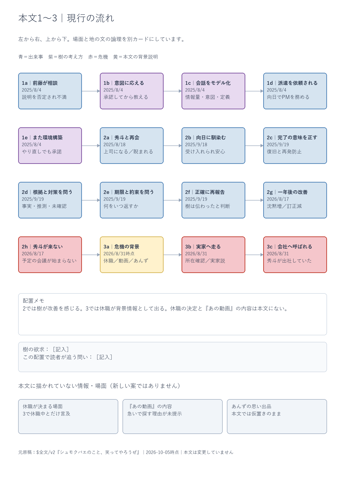

---
tags:
  - diopsidae
  - map
  - obsidian
date: 2026-10-05
---

# 本文1〜3の骨格と組み換え

[編集用draw.io](本文1〜3_骨格と組み換え_2026-10-05.drawio)に、現稿の1〜3を16枚のカードとして整理した。

元原稿は[v2統合原稿](../本文/%24全文/v2/シュモクバエのこと、笑ってやろうぜ.md)。本文と従来のプロット図は変更していない。並べ替えページは、既存の内容の配置候補であり、採用済みの構成ではない。

## 四つのページ

| ページ | 内容 |
| --- | --- |
| 01 現行順 | 前藤への指導 → 派遣 → 秀斗との再会 → 向日での改善 → 秀斗の不在 → 実家へ → 会社への呼び出し |
| 02 並べ替え・派遣から | 派遣と再会を先に置き、前藤との会話を以前の職場の回想にする |
| 03 並べ替え・危機から | 秀斗の不在と呼び出しを先に置き、1〜2を回想する |
| 04 自由組み換え | 全カードと広い空白。場面も樹の考え方も個別に動かせる |

各ページは左から右、上から下へ読む。カードの「1a」「2b」などは元の章内の位置を示し、並べ替え後も変わらない。

## 操作

1. 編集用draw.ioをdraw.ioで開く。
2. 下部の「04 自由組み換え」を選ぶ。
3. カードを右の空白へドラッグして、読む順番に置く。
4. 文章を変える場合はカードをダブルクリックする。
5. 編集した図を保存する。

別案を残す場合はページを複製する。カードにカーソルを重ねると、元本文の内容を詳しく確認できる。青は出来事、紫は樹の考え方、赤は危機、黄は背景説明。

## 現稿で空いている箇所

「秀斗の休職が決まる場面」「あの動画の内容」「あんずの思い出品」は、本文に描かれていないか、仮置きのまま。灰色のカードで本編と分けた。

「実家が病状を悪化させた」「医療につなげれば治る」は樹の仮説として扱っている。秀斗の休職原因として確定していない。

派遣から始める案では前藤の回想への入り方、危機から始める案では回想後に現在へ戻る接続を、組み換え後に検討する。

## 内容確認用プレビュー

編集はdraw.ioで行う。下の画像は現行順の内容確認用。

